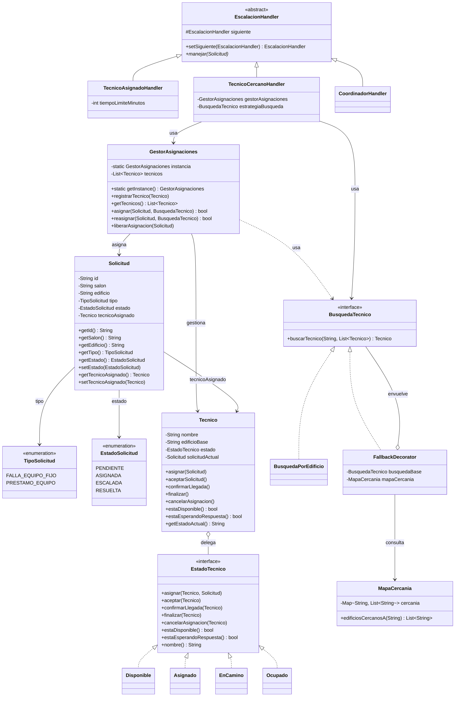

# Proyecto de Diseño de Software – Corte Uno
## Módulo de Asignación de Solicitudes de Soporte Técnico

### Nombres 
* María José Almanza Caviedes
* Pablo Andrés Tamayo Gonzalez
* Amy Janine Nossa Ramirez
* Simon Martinez García

## Link Presentación https://canva.link/p0a6pdp6muhu0kh

---

## 1. Presentación del Problema

En la Universidad de La Sabana, cada salón cuenta con un número de teléfono
para solicitar soporte técnico: fallas de equipos fijos o préstamo de
equipos adicionales, disponibles a través de "carritos" móviles ubicados
solo en algunos edificios del campus. Este proceso afecta directamente a
**estudiantes y profesores**, cuyas clases se interrumpen mientras esperan
una solución, y al **personal de soporte**, que debe desplazarse entre
edificios sin visibilidad de dónde se le necesita con mayor urgencia.

El problema no es solo humano sino estructural: no hay registro de una
solicitud existente si nadie contesta la llamada, no hay forma de saber si
a un técnico ya se le asignó otra solicitud, y los edificios sin carrito
propio simplemente se quedan sin cobertura o con demoras extensas.
Pensamos en crear un software que permita algo que el proceso manual no
puede garantizar: que ninguna solicitud se pierda, que el estado de cada
una sea visible en tiempo real, y que la asignación de personal se haga de
forma consistente incluso bajo carga concurrente, como podría ocurrir en
la semana de parciales.

**Alcance de este módulo (Corte 1):** el sistema implementado cubre
únicamente el **módulo de asignación de solicitudes** — recepción de una
solicitud, búsqueda y asignación de un técnico disponible (con fallback a
edificios cercanos), control del ciclo de vida del técnico, y escalación
cuando el técnico asignado no responde.

Qué falta aún por hacer (fuera de alcance de este corte):

- Interfaz de usuario para estudiantes/profesores (creación de solicitudes vía formulario o app).
- Persistencia en base de datos real (se usa almacenamiento en memoria).
- Autenticación y roles de usuario.
- Cálculo real de distancias geográficas entre edificios (se usa un mapa de cercanía fijo, a modo de simulación).
- Panel de monitoreo del coordinador.
- Un temporizador real que dispare la escalación automáticamente tras N minutos sin intervención manual (por ahora, `TecnicoAsignadoHandler` evalúa el estado del técnico cuando se invoca la cadena, pero nada la invoca todavía por sí solo con base en tiempo transcurrido).

---

## 2. Fundamentos de Ingeniería de Software

| Atributo de calidad | ¿Cómo se sostiene en el diseño? (evidencia concreta) | ¿Qué se sacrificó a cambio? |
|---|---|---|
| **Disponibilidad / confiabilidad** | La cadena `TecnicoAsignadoHandler → TecnicoCercanoHandler → CoordinadorHandler` garantiza que ninguna solicitud queda sin respuesta: siempre hay un último eslabón (`CoordinadorHandler`) que la atiende si todo lo demás falla. | Se añade latencia: una solicitud que falle en cada eslabón tarda más en resolverse que si un solo componente decidiera todo de una vez. |
| **Consistencia (evitar condiciones de carrera)** | `GestorAsignaciones` es un Singleton con los métodos `asignar()`, `reasignar()` y `liberarAsignacion()` sincronizados (`synchronized`), por lo que dos solicitudes casi simultáneas nunca pueden asignar el mismo técnico dos veces. Esto se probó en `Main.java` lanzando dos hilos concurrentes contra el mismo técnico. | El método sincronizado se convierte en un cuello de botella: si el volumen de solicitudes creciera mucho, esa sección serializada limitaría el paralelismo del sistema. |
| **Extensibilidad de la búsqueda de técnico** | `BusquedaTecnico` es una interfaz; `FallbackDecorator` añade la lógica de cercanía sin tocar `BusquedaPorEdificio`. Se pueden agregar más decoradores (ej. priorizar por tipo de solicitud) sin modificar el código existente. | Cada decorador añade una capa de indirección: para entender por completo cómo se elige un técnico hay que seguir la cadena de decoradores, no basta con leer una sola clase. |

---

## 3. Diseño de Software

### 3.1 Principios SOLID aplicados

**SRP (Single Responsibility Principle) — con evidencia antes/después:**

```java
// ANTES (violación): GestorAsignaciones mezclaba la búsqueda de técnico,
// la asignación y la decisión de reintentos, todo en un único método gigante.
class GestorAsignaciones {
    Tecnico asignar(Solicitud s, List<Tecnico> tecnicos) {
        for (Tecnico t : tecnicos) {
            if (t.getEdificioBase().equals(s.getEdificio()) && t.estaDisponible()) {
                t.asignar(s);
                return t;
            }
        }
        // más lógica aquí: buscar en edificios cercanos, reintentar, etc.
        return null;
    }
}
// Problema: si mañana cambia la estrategia de búsqueda (por ejemplo, priorizar
// por carga en vez de por edificio), hay que modificar la misma clase que
// también es responsable de coordinar la asignación en sí.

// DESPUÉS: responsabilidades separadas
interface BusquedaTecnico {
    Tecnico buscarTecnico(String edificio, List<Tecnico> tecnicos);
}
class GestorAsignaciones {
    synchronized boolean asignar(Solicitud s, BusquedaTecnico estrategia) {
        Tecnico t = estrategia.buscarTecnico(s.getEdificio(), tecnicos);
        if (t == null) return false;
        t.asignar(s);
        s.setTecnicoAsignado(t);
        return true;
    }
}
// GestorAsignaciones ya no sabe CÓMO se busca un técnico, solo QUÉ hacer
// una vez encontrado. Cambiar la estrategia de búsqueda no toca esta clase.
```

**OCP (Open/Closed Principle):** agregar una nueva forma de decidir a qué
técnico asignar una solicitud (por ejemplo, `PrioridadPorTipoDecorator`) se
hace creando una clase nueva que implemente `BusquedaTecnico`, sin modificar
`GestorAsignaciones`, `BusquedaPorEdificio` ni `FallbackDecorator`.

**DIP (Dependency Inversion Principle):** `GestorAsignaciones.asignar()` y
`reasignar()` dependen de la abstracción `BusquedaTecnico`, no de una
implementación concreta como `BusquedaPorEdificio`. La estrategia concreta
se inyecta como parámetro, igual que `TecnicoCercanoHandler` depende de la
misma abstracción en lugar de instanciar su propia lógica de búsqueda.

### 3.2 Patrones de diseño utilizados

| Patrón | Categoría | Problema que resuelve aquí | Por qué no se usó otra alternativa |
|---|---|---|---|
| **Singleton** | Creacional | Garantiza un único `GestorAsignaciones` por el que pasa toda asignación, evitando que dos procesos asignen el mismo técnico a la vez (condición de carrera). | Se descartó pasar el gestor como dependencia inyectada manualmente en cada punto del código porque el requisito real es que exista una única instancia coordinando el estado compartido de los técnicos; un Factory no resuelve eso, ya que seguiría permitiendo múltiples instancias. |
| **State** | Comportamiento | Modela el ciclo de vida del técnico (`Disponible`, `Asignado`, `EnCamino`, `Ocupado`) como objetos que solo permiten transiciones válidas, evitando que el estado se desactualice respecto a la realidad. El estado `Asignado` distingue "le llegó la solicitud" de "ya confirmó y va en camino", lo cual da un punto de control adicional antes de comprometer al técnico. | Se descartó manejar el estado como un `enum` con un `switch` externo porque la validación de transiciones quedaría dispersa en cada lugar que modifica el estado, en vez de encapsulada en el propio estado. |
| **Chain of Responsibility** | Comportamiento | Modela la escalación de una solicitud no atendida como una cadena de manejadores (técnico asignado → técnico cercano → coordinador), garantizando que ninguna solicitud queda huérfana. | Se descartó un único método con `if/else` anidados para los 3 niveles de escalación porque agregar un nuevo nivel (por ejemplo, notificar a un supervisor de zona) obligaría a modificar ese método central en vez de solo añadir un eslabón nuevo. |
| **Decorator** | Estructural | Envuelve la búsqueda base por edificio (`BusquedaPorEdificio`) con `FallbackDecorator`, que añade la búsqueda en edificios cercanos sin modificar la lógica original, resolviendo la cobertura desigual entre edificios. | Se descartó crear una subclase `BusquedaPorEdificioConFallback` porque el Decorator permite combinar capas de comportamiento dinámicamente (por ejemplo, envolver de nuevo con una futura capa de notificación) sin generar una jerarquía de subclases para cada combinación posible. |

### 3.3 Modelado UML



**Tabla de trazabilidad:**

| Clase en el diagrama | Archivo en el repositorio | Coincide en atributos/métodos clave |
|---|---|---|
| `Solicitud` | `/src/modelo/Solicitud.java` | Sí |
| `TipoSolicitud` | `/src/modelo/TipoSolicitud.java` | Sí |
| `EstadoSolicitud` | `/src/modelo/EstadoSolicitud.java` | Sí |
| `Tecnico` | `/src/tecnicos/Tecnico.java` | Sí |
| `EstadoTecnico` | `/src/tecnicos/EstadoTecnico.java` | Sí |
| `Disponible` | `/src/tecnicos/Disponible.java` | Sí |
| `Asignado` | `/src/tecnicos/Asignado.java` | Sí |
| `EnCamino` | `/src/tecnicos/EnCamino.java` | Sí |
| `Ocupado` | `/src/tecnicos/Ocupado.java` | Sí |
| `GestorAsignaciones` | `/src/asignacion/GestorAsignaciones.java` | Sí |
| `BusquedaTecnico` | `/src/busqueda/BusquedaTecnico.java` | Sí |
| `BusquedaPorEdificio` | `/src/busqueda/BusquedaPorEdificio.java` | Sí |
| `FallbackDecorator` | `/src/busqueda/FallbackDecorator.java` | Sí |
| `MapaCercania` | `/src/busqueda/MapaCercania.java` | Sí |
| `EscalacionHandler` | `/src/escalacion/EscalacionHandler.java` | Sí |
| `TecnicoAsignadoHandler` | `/src/escalacion/TecnicoAsignadoHandler.java` | Sí |
| `TecnicoCercanoHandler` | `/src/escalacion/TecnicoCercanoHandler.java` | Sí |
| `CoordinadorHandler` | `/src/escalacion/CoordinadorHandler.java` | Sí |

---

## 4. Implementación

Estructura del código:

```
src/
├── Main.java                 # Demo con 4 escenarios, incluye prueba de concurrencia real con hilos
├── modelo/
│   ├── Solicitud.java
│   ├── TipoSolicitud.java
│   └── EstadoSolicitud.java
├── tecnicos/                 # Patrón State
│   ├── Tecnico.java
│   ├── EstadoTecnico.java
│   ├── Disponible.java
│   ├── Asignado.java
│   ├── EnCamino.java
│   └── Ocupado.java
├── asignacion/                # Patrón Singleton
│   └── GestorAsignaciones.java
├── busqueda/                  # Patrón Decorator
│   ├── BusquedaTecnico.java
│   ├── BusquedaPorEdificio.java
│   ├── FallbackDecorator.java
│   └── MapaCercania.java
└── escalacion/                 # Patrón Chain of Responsibility
    ├── EscalacionHandler.java
    ├── TecnicoAsignadoHandler.java
    ├── TecnicoCercanoHandler.java
    └── CoordinadorHandler.java
```

**Instrucciones de ejecución:**

```bash
# Desde la carpeta src/
javac -d ../out $(find . -name "*.java")
java -cp ../out Main
```

`Main.java` corre 4 escenarios: asignación con fallback geográfico
(Decorator), asignación concurrente real usando dos hilos que compiten por
el mismo técnico (Singleton sincronizado), transiciones de estado válidas
e inválidas (State), y escalación completa de una solicitud sin técnico
disponible (Chain of Responsibility).

---

## 5. Análisis Técnico

**Alta cohesión:** cada clase tiene una única razón de cambiar. `Tecnico`
solo gestiona su propio estado (delegado a `EstadoTecnico`); `GestorAsignaciones`
solo coordina la asignación/reasignación/liberación; la lógica de "cómo
encontrar un técnico" vive enteramente en el paquete `busqueda`, separada
de "qué hacer una vez encontrado".

**Bajo acoplamiento:** `GestorAsignaciones` y `TecnicoCercanoHandler`
dependen de la interfaz `BusquedaTecnico`, no de `BusquedaPorEdificio` ni
de `FallbackDecorator` directamente. Esto se comprueba en `Main.java`: el
escenario de concurrencia usa `busquedaLocal` directamente, mientras que
el escenario de cobertura desigual usa la misma interfaz envuelta en
`FallbackDecorator`, sin que `GestorAsignaciones` necesite saber cuál de
las dos está recibiendo.

**Extensiones futuras que el diseño facilita:**
- Agregar un nuevo estado del técnico (ej. `EnDescanso`) implementando `EstadoTecnico`.
- Agregar un nuevo nivel de escalación (ej. notificar a un supervisor de zona) como un nuevo `EscalacionHandler` en la cadena.
- Agregar una nueva estrategia de búsqueda (ej. por carga de trabajo) implementando `BusquedaTecnico`.
- Implementar una clase `ProgramadorEscalacion` con `ScheduledExecutorService` para que la escalación se dispare sola tras un tiempo límite, sin depender de que algo externo invoque la cadena manualmente.

**Límites honestos del diseño:** el `GestorAsignaciones` sincronizado
resuelve la condición de carrera dentro de una sola instancia de la
aplicación, pero si el sistema creciera a múltiples instancias/servidores
(escalado horizontal), `synchronized` ya no sería suficiente — se
necesitaría un mecanismo de bloqueo distribuido, que está fuera del
alcance de este módulo. Tampoco se modela aún la persistencia: si la
aplicación se reinicia, se pierde el estado de técnicos y solicitudes en
memoria. Y, como se señaló, la escalación por tiempo aún depende de que
algo externo llame `cadenaEscalacion.manejar()` — no ocurre todavía sola.

---

## 6. Créditos y Roles

| Integrante | Rol / contribución principal |
|---|---|
| *(completar)* | *(completar)* |
| *(completar)* | *(completar)* |

---

### Recordatorio de entregables
- [x] Código funcional del módulo de asignación (patrones + SOLID)
- [x] Wiki completo (este documento)
- [ ] Repositorio en GitHub — ya subido, pendiente completar créditos
- [ ] Presentación creativa (video) — a cargo del equipo, por aparte
